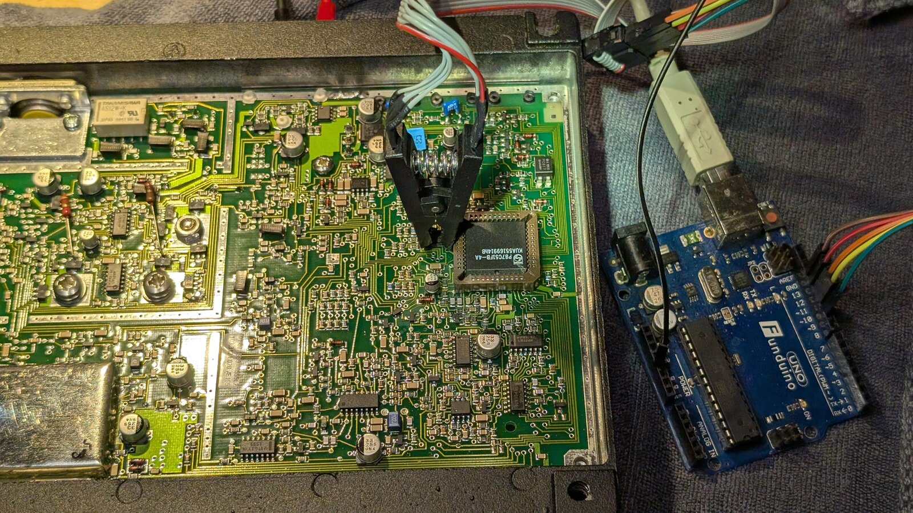

# Simrad Shipmate RS8300 – reprogramming the ATIS

On a **Simrad Shipmate RS8300** (inland VHF radio, built around 1999) the ATIS ID can be entered on the handset only once. After that it is locked, and according to the manual only an authorized dealer may change it. The dealer tool for this is no longer available.

This repository shows how to read and rewrite the ATIS directly in the radio's EEPROM with an **Arduino Uno** and a **SOIC-8 test clip**, without any soldering.



*The SOIC-8 clip sits on the NM93C46 (U18) just above and to the left of the socketed P87C51FB. In this photo the microcontroller is still in its socket – pull it before powering the EEPROM from the Arduino (see [Procedure](#procedure)).*

> [!IMPORTANT]
> **Legal:** A radio may only transmit with the ATIS assigned to the vessel by the responsible authority (in Germany: Bundesnetzagentur). These tools are meant for changing a radio to your **own, assigned** ID, for example after a change of ownership or when installing a used radio.
>
> Use at your own risk. Make a backup before every change; the tool does this automatically.

## Summary

| ATIS digits | Location in the NM93C46 (64 × 16 bit) | Example `9211234567` |
|---|---|---|
| 1–4 | word **0x2E**, BCD | `9211` |
| 5–8 | word **0x2F**, BCD | `2345` |
| 9–10 | word **0x3D**, **high byte**, BCD | `67xx` (do not change the low byte) |

- **No checksum.** The firmware accepts changed values at the next power-on.
- On the handset, **`E ↑ 88 E`** shows digits 1–5 and **`E ↑ 87 E`** shows digits 6–10. The ATIS is entered with `E ↑ 82 E` / `E ↑ 83 E` as long as it is not yet locked.
- High byte of word 0x3C = squelch setting. Word 0x30 is not related to the ATIS.
- **MMSI:** An RS8300 without DSC (no distress button) has no MMSI. `E ↑ 97/98 E` and `E ↑ 92/93 E` then show `error`. That is normal.

Determined on a unit with firmware label "017" on the 87C51, through targeted write tests and reading back on the handset. Other firmware versions might differ, so check with `dump` and `show` first.

## EEPROM map

The NM93C46 is organized as 64 words × 16 bit (ORG pin tied to VCC); all addresses below are word addresses. Only the entries marked **verified** were confirmed by writing a value and checking the result on the handset. Everything else is an observation from dumps of a single unit.

| Words | Content | Status |
|---|---|---|
| 0x00–0x0F | Nibble-coded data: every nibble holds a small value (seen: 0, 1, 2, F). Possibly per-channel flags (e.g. scan or favourite lists). | unverified |
| 0x10–0x13 | `FFFF` (empty) | observation |
| 0x14–0x1D | One decimal digit per byte in the high nibble, low nibble always `F`. Purpose unknown. | unverified |
| 0x1E–0x2D | `FFFF` (empty) | observation |
| **0x2E** | **ATIS digits 1–4**, packed BCD | **verified** |
| **0x2F** | **ATIS digits 5–8**, packed BCD | **verified** |
| 0x30 | Unknown. Changing the high byte had **no** effect on the displayed ATIS. | verified (not ATIS) |
| 0x31–0x37 | `0000` | observation |
| 0x38–0x3B | Device-specific values, probably calibration data (the schematic shows D/A converters for REF-ADJ, VCO, BUF-ADJ, squelch, power level and AF level, loaded from the controller). | unverified |
| **0x3C** | **High byte: squelch setting** (changed when the squelch was adjusted on the radio); low byte unknown | **verified** (high byte) |
| **0x3D** | **High byte: ATIS digits 9–10**, packed BCD; low byte unknown – leave it unchanged | **verified** (high byte) |
| 0x3E–0x3F | Device-specific values, probably calibration data | unverified |

Findings:

- **The ATIS is split:** eight digits sit in 0x2E/0x2F, the last two in the high byte of 0x3D, far away from the rest. A search for the full number in a dump will therefore only find the first eight digits.
- **No checksum** protects the ATIS. Changed values are accepted at the next power-on without any error message.
- **The firmware writes user settings to the same EEPROM** during normal operation (squelch in 0x3C). Expect such words to differ between dumps.
- **The handset lock** (82/83 → `error`) is implemented in the firmware. How the firmware decides that the ATIS is "programmed" (e.g. field not `FFFF`, or a separate flag) has not been examined; writing the EEPROM directly makes that unnecessary.
- **Do not erase the whole chip.** The words in 0x38–0x3F most likely hold the factory calibration. Always keep your first full dump.

### MMSI

The RS8300/8400 manual describes MMSI entry (`E ↑ 92/93 E`) and display (`E ↑ 98/97 E`). On units with DSC the MMSI is probably stored in this EEPROM in a similar way (BCD), and the empty `FFFF` areas would leave room for it. The test unit has **no DSC support**, though, and returns `error` for all MMSI functions, so where and how the MMSI is stored **could not be verified**. If you have a DSC-equipped unit, a dump before and after entering the MMSI on the handset will show its location.

## Hardware

- Arduino Uno or Nano (5 V)
- SOIC-8 test clip with an adapter to a breadboard or jumper wires
- Optional: multimeter

Inside the main unit:

| Part | Type | Purpose |
|---|---|---|
| U13 | 87C51FB, PLCC-44, socketed | microcontroller with firmware |
| **U18** | **NM93C46**, SO-8 | 1-kbit Microwire EEPROM, ORG tied to VCC, i.e. 64 × 16 bit |

U18 sits just above and to the left of the PLCC socket of the microcontroller (see the photo at the top).

## Wiring

| NM93C46 | Signal | Arduino |
|---|---|---|
| 1 | CS | D10 |
| 2 | SK | D13 |
| 3 | DI | D11 |
| 4 | DO | D12 |
| 5 | GND | GND |
| 8 | VCC | **5V** |
| 6 / 7 | ORG / NC | leave unconnected |

## Procedure

> [!WARNING]
> **The radio cannot be switched on without the microcontroller.** It is switched on via the handset, which the microcontroller handles. The EEPROM is therefore powered by the Arduino.
>
> In doing so, the Arduino also powers the board's entire 5 V rail. So beforehand **always disconnect the 12 V supply** and **pull the 87C51 from its socket**. Otherwise the microcontroller runs as well and interferes with the Arduino on the bus.

1. **Disconnect 12 V**, open the radio, **pull the 87C51**. Note the position of pin 1.
2. Measure the resistance between EEPROM pin 8 and pin 5 to rule out a short.
3. Attach the clip (mind pin 1) and wire it as shown above.
4. Flash the sketch:
   ```sh
   pio run -e uno -t upload        # or: -e nano
   ```
   Alternatively open `src/mw93c46.ino` in the Arduino IDE and upload it.
5. Install the Python dependency: `pip install pyserial`
6. Make a **backup** and show the current ATIS:
   ```sh
   python3 atis.py dump
   ```
   Keep the dump in `dumps/` safe. It also contains the radio's calibration values.
7. **Write the new ATIS.** A backup is made automatically first; afterwards the result is read back and verified:
   ```sh
   python3 atis.py set 9211234567
   ```
8. Disconnect the Arduino 5 V, remove the clip, reinsert the 87C51, connect 12 V.
9. Switch on via the handset and check with `E ↑ 88 E` and `E ↑ 87 E`.

To go back to the previous state:
```sh
python3 atis.py restore dumps/nm93c46_<date>_dump.bin
```

## Tools

### `src/mw93c46.ino`: Arduino sketch
Microwire driver for the 93C46 in 64×16 mode. Controlled over the serial port (115200 baud, line ending `\n`, all values hex):

| Command | Function |
|---|---|
| `d` | dump the whole EEPROM |
| `r <adr>` | read one word |
| `w <adr> <word>` | write one word, then read it back and verify |

The sketch never uses ERASE or ERAL. That way it also works with replacement parts such as the AK93C45A, which do not support these commands.

### `atis.py`: Python tool
| Command | Function |
|---|---|
| `dump` | read three times, compare, save a backup |
| `show` | show the stored ATIS |
| `set <atis>` | make a backup, write the ATIS, verify |
| `restore <file>` | write a backup back (only the words that differ) |

Optional: `--port /dev/ttyACM0`. Without it, the tool uses the first serial port it finds.

## Troubleshooting

- **The first read after connecting returns only `0000` in 0x00–0x0F:** This is a known effect on the first access. `atis.py` therefore discards the first dump and then reads three times for comparison.
- **The dumps differ, or all words are `FFFF` or `0000`:** The clip is not seated properly, pin 1 is reversed, or pin 8 has no 5 V.
- **The handset shows `error` for 82/83:** The ATIS is locked. That is exactly what this repository is for.

## Sources

- Manual RS8300/8400: [RigPix – Shipmate RS-8300](https://rigpix.com/marine/shipmate_rs8300.htm) (download the PDF from that page; RigPix blocks direct links from other sites)
- Schematics RS8300/8400 (peel.dk): <https://www.peel.dk/Shipmate/Equipment/Shipmate%20RS8300-8400%20-%20Marine%20VHF%20Radiotelephone%20(Schematics,%20bad%20quality%20scan).pdf>
- AK93C45A datasheet (replacement part): <https://mm.digikey.com/Volume0/opasdata/d220001/medias/docus/2521/AK93C45A_55A_64A_75A.pdf>

## License

[MIT](LICENSE)
